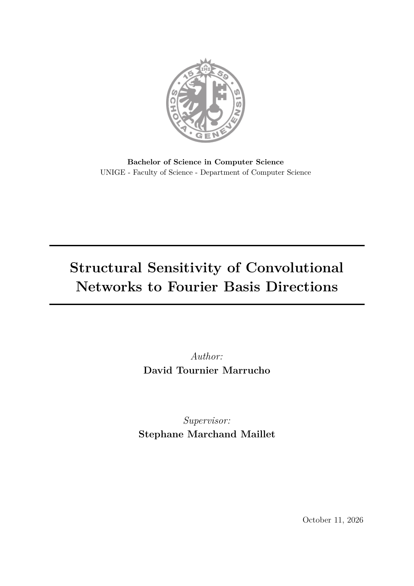

[](report/main_en.pdf)

# Bachelor Project: CNN Robustness and Fourier Analysis

This repository contains the code, experimental scripts, and report for my Bachelor project on the frequency sensitivity of convolutional neural networks. The English report is the primary public version; the original French thesis is preserved as the original-language version.

The project studies how directions from the Fourier basis can induce structured adversarial perturbations on CNNs trained on CIFAR-10 and CIFAR-100. It focuses on a targeted reproduction with convolutional models, frequency-sensitivity heatmaps, random-noise baselines, epsilon sweeps, and stability analyses.

The compiled reports are available at:

- **[English report](report/main_en.pdf)** — primary public version
- [Original French report](report/main.pdf) — original-language version

## Research Question

> How does the convolutional architecture of CNNs induce privileged vulnerability directions in the Fourier domain, and to what extent does this structural sensitivity explain the existence of universal adversarial perturbations?

## Repository Contents

```text
.
├── Makefile
├── README.md
├── environment.yml
├── pyproject.toml
├── report/
│   ├── main.pdf
│   ├── main.tex
│   ├── main_en.pdf
│   ├── main_en.tex
│   ├── sections/
│   ├── sections_en/
│   ├── appendices/
│   ├── appendices_en/
│   ├── formalisme/
│   └── figures/
├── scripts/
│   ├── build_english_localized_figures.py
│   ├── build_report_figures.py
│   ├── evaluate_random_noise_baseline.py
│   ├── evaluate_sfa_epsilon_sweep.py
│   ├── evaluate_sfa_stability.py
│   └── generate_fourier_heatmap.py
└── src/
    ├── config.py
    ├── data.py
    ├── fourier.py
    ├── models.py
    ├── sfa_evaluation.py
    ├── train.py
    └── utils.py
```

## Installation

The reference environment is described in `environment.yml`.

```bash
conda env create -f environment.yml
conda activate Fourier_Adversarial_Attack
```

## Main Commands

Show the project help:

```bash
make help
```

By default, the scripts read from and write to:

```text
data/
outputs/models/
outputs/runs/
outputs/figures/
```

These directories are ignored by Git to keep the public repository lightweight.

## Models and Datasets

Implemented models:

- `custom_cnn`: a small reference CNN.
- `vgg_small_bn`: a simplified VGG-style architecture with BatchNorm.

Datasets supported by the code:

- `cifar10`
- `cifar100`

## Report

The English report is the primary public version of this project. The original French thesis is preserved alongside it as the original-language version. Their entry points and language-specific sources are:

```text
French:  report/main.tex     report/sections/     report/appendices/
English: report/main_en.tex  report/sections_en/  report/appendices_en/
```

The figures in `report/figures/` are the final committed figures used by the reports, so compiling either report does not rerun experiments. English-localized figures use the `_en.pdf` suffix where a separate asset is required. Intermediate artifacts used to produce the figures remain local in `outputs/` and are not published.

Compiling the reports requires a working LaTeX installation, `latexmk`, and the LaTeX packages imported by the sources. These targets compile directly from the committed figures:

```bash
make report-fr
make report-en
make reports
```

Figure regeneration remains an explicit, separate operation:

```bash
make figures
```

## Reproducibility Notes

The public repository allows the code to be rerun and the report to be recompiled, but it does not include trained checkpoints or heavy experimental outputs. A full regeneration of all figures from scratch therefore requires retraining the models or restoring local artifacts into `outputs/`.

The project focuses on CNNs and the CIFAR-10/CIFAR-100 datasets. Vision Transformer experiments are not included in this public repository.
