# Projet de Bachelor : Robustesse des CNN et Analyse de Fourier

 

 

 

 

 

 

 

Ce dépôt contient le code et les expériences de mon projet de Bachelor.
L'objectif est d'étudier la sensibilité structurelle des réseaux de neurones (CNN et ViT) aux directions des fonctions de base de Fourier.

## Analyse complementaire : marges logits et frontieres locales

Le script ci-dessous compare les checkpoints VGGSmallBN CIFAR-10 et CIFAR-100 sans reentrainement. Il calcule les statistiques de marges logits, genere un histogramme comparatif et sauvegarde des coupes locales de frontiere de decision autour de quelques images correctement classees.

```bash
/home/david/miniconda3/envs/ProjetBachelor/bin/python scripts/analyze_decision_margins.py \
  --cifar10-checkpoint outputs/models/vgg_small_bn_cifar10_final.pth \
  --cifar100-checkpoint outputs/models/vgg_small_bn_cifar100_final.pth \
  --output-dir outputs/runs/decision_margins_vgg_small_bn_cifar10_cifar100
```

## Problématique

> Comment l'architecture convolutionnelle des CNN induit-elle des directions de vulnérabilité privilégiées dans le domaine de Fourier, et dans quelle mesure cette sensibilité structurelle explique-t-elle l'existence de perturbations adversariales universelles ?

## Pipeline du Projet

Le diagramme ci-dessous illustre les différentes phases du projet.

```mermaid
flowchart TB

    subgraph P0 ["Phase 0 : Cadrage scientifique"]
        direction LR
        B0["Définition du cadre : base de Fourier, DFT2D/iDFT..."] --> C0[["Livrable : problématique"]]
    end

    subgraph P1 ["Phase 1 : Fondements théoriques"]
        direction LR
        A1["Relecture mathématique"] --> B1["Analyse des bases TH a introduire"] --> C1[["Livrable : section théorique propre"]]
    end

    subgraph P2 ["Phase 2 : Protocole expérimental"]
        direction LR
        T2["Setup technique : PyTorch/CUDA, GPU, logs, reproductibilité"] --> A2["Choix protocole & DataLoaders"] --> B2["Définition du pipeline minimal"] --> C2[["Livrable : protocole figé"]]
        A2prime["Debut de la redemonstration"]
    end

    subgraph P3 ["Phase 3 : Reproduction theorique/pratique"]
        direction LR
        A3["Application sur CNN"] --> B3["Génération des heatmaps"] --> C3["Comparaison avec le papier"] --> D3[["Livrable : reproduction CNN"]]
        A3prime["Fin de la redemonstration"]
    end

    subgraph P4 ["Phase 4 : Lecture interprétative"]
        direction LR
        A4["Analyse des resultats"] --> B4["Lien structure CNN faille"] --> C4[["Livrable : interprétation claire"]]
    end

    subgraph P5 ["Phase 5 : Extension ViT (BONUS)"]
        direction LR
        A5["Transposer à ViT"] --> B5["Produire heatmaps comparables"] --> C5["Identifier limites"] --> D5[["Livrable : extension exploratoire"]]
    end

    subgraph P6 ["Phase 6 : Synthèse"]
        direction LR
        A6["Structurer le rapport"] --> B6["Expliciter les limites"] --> C6[["Livrable finalisé"]]
    end

    C0 --> A1
    C1 --> M1{"Rendez-vous 2 (semaine 7) :<br/>Validation<br/>Théorie"}:::meeting
    M1 --> T2
    M1 --> A2prime
    C2 --> M2{"Rendez-vous 3 (semaine 9) :<br/>Validation<br/>Protocole"}:::meeting
    A2prime --> M2
    M2 --> A3
    M2 --> A3prime
    A3prime --> A4
    D3 --> A4
    C4 --> M3{"Rendez-vous 4 (semaine 12) :<br/>Analyse CNN<br/>& Go/No-Go ViT"}:::meeting
    M3 --> A5
    M3 --> A6
    D5 --> M4{"Rendez-vous 5 (semaine 14) :<br/>Revue plan"}:::meeting
    M4 --> A6
    C6 --> M5{"Dernier rendez-vous (semaine 16) :<br/>Revue plan"}:::meeting

    classDef phase fill:#2d3436,stroke:#636e72,stroke-width:1px,color:#dfe6e9,rx:6,ry:6;
    classDef keynode fill:#0984e3,stroke:#2d3436,stroke-width:2px,color:#ffffff,rx:6,ry:6;
    classDef critical fill:#ff7675,stroke:#2d3436,stroke-width:2px,color:#ffffff,rx:6,ry:6;
    classDef output fill:#00cec9,stroke:#2d3436,stroke-width:2px,color:#2d3436,rx:10,ry:10;
    classDef meeting fill:#ffeaa7,stroke:#e17055,stroke-width:3px,color:#2d3436;

    class B0,A1,B1,T2,A2,B2,A3,B3,A4,B4,A6,B6 phase;
    class A1,A3,A5 keynode;
    class B1,C3,C5 critical;
    class C0,C1,C2,D3,C4,D5,C6 output;
```


